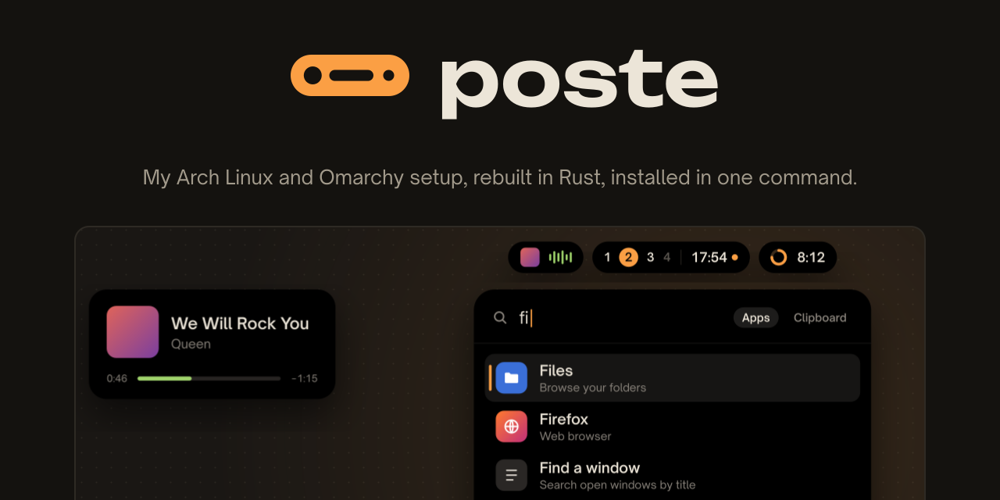
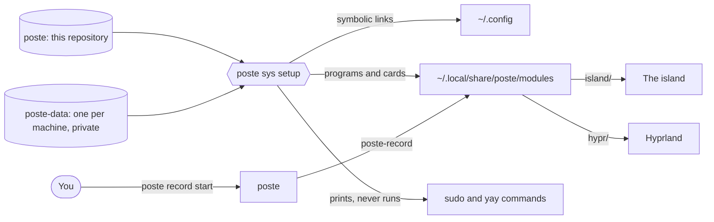

<div align="center">



[](https://github.com/KristenJestin/poste/actions/workflows/archive.yml)
[](https://github.com/KristenJestin/poste/releases/tag/latest)
[](https://github.com/KristenJestin/poste/commits/main)

</div>

## What it is

My Arch Linux and Omarchy setup, rebuilt in Rust. It replaced a dotfiles repository managed by
chezmoi: the config of `~`, the Hyprland settings, the Quickshell island that replaces Omarchy's
bar, the packages, the steps that rebuild a machine, and small modules for the everyday stuff
(screen recording, AI agent quotas, file search, battery alerts). One command installs it on a
fresh Omarchy, and the same command brings a machine up to date.

Three rules shape it:

- **`poste` knows no module.** It is a thin dispatcher, like git: `poste record start` runs the
  program `poste-record`. A module is a folder with its program, its card, and the pieces it brings
  to the island and to Hyprland. Take the folder away and nothing of it is left on the machine.
- **Setup never overwrites what it did not put there, and never runs `sudo`.** It shows what it
  will do, asks about every conflict, keeps a copy of what it replaces, and prints the root
  commands for you to run.
- **The repository is the same on every machine.** What belongs to one machine (screens, mounts,
  its own steps) lives in a second, private repository, `poste-data`, laid over this one.

## How it fits together



1. **The config is linked, not copied.** Editing a file in `~` edits the repository; there is no
   drift and nothing to send back.
2. **Each module carries its own pieces.** The island and Hyprland load whatever the installed
   modules bring (launcher entries, island slots, shortcuts, systemd units), without naming any.
3. **Two sources of truth, one per audience.** This public repository says how the machine works;
   `poste-data` says what is specific to one machine. `poste sys sync` pulls both and runs setup.
4. **Run from a clone or from a release.** A machine can follow the clone (`dev`) or an archive
   built by GitHub Actions on every push to `main` (`release`), and roll back to an earlier one.

Quick start on a fresh Omarchy: [Install on a new PC](#install-on-a-new-pc).

## The dispatcher

`poste` is a thin dispatcher, like git: `poste <module> <args…>` runs the
program `poste-<module>` with `<args…>` (process replacement on Unix, exit
code passed through). It only knows `help`, `--help` and `--version`; no module
name is hard-coded.

How a module is found, in order, the first hit wins:

1. `~/.local/share/poste/modules/<name>/poste-<name>`
2. each folder of the `modules` key of `~/.config/poste/config.toml`
   (`poste-<name>` directly, or `<name>/poste-<name>`)
3. the `PATH`

`XDG_DATA_HOME`, `XDG_CONFIG_HOME` and `XDG_STATE_HOME` are honoured.

`poste help` (or `poste` alone) lists the modules found at that moment, with the
description from their card. `poste help <module>` shows the commands of the card.
An unknown module gives a clear error, the list of modules and exit code 127.

### Configuration

`~/.config/poste/config.toml`:

```toml
repo = "/path/to/the/repository"   # written by ./setup
source = "release"                  # written by poste sys use: an installed version, or "dev" (the clone, default)
modules = ["~/my-modules"]          # optional: extra module folders
```

### A module card: `module.toml`

Next to the module's program:

```toml
name = "sys"
description = "Manages the poste repository"
commands = [{ name = "status", description = "state of the repository" }]   # optional
```

## Modules

| Module | Role |
| --- | --- |
| [`sys`](modules/sys/README.md) | manages the repository: build, install, status, git. Always installed. |
| [`record`](modules/record/README.md) | screen recording (gpu-screen-recorder) driven by the island: presets, windows, screens, region. |
| [`usage`](modules/usage/README.md) | AI agent quotas (Claude Code, Codex…) read from Omarchy's collector, their history, and the consumption read back from the agents' logs (calls, 5 h windows, comparisons). |
| [`power`](modules/power/README.md) | battery alerts (low, critical, plugged in but draining) and almost-full disk; light daemon (laptops). |
| [`files`](modules/files/README.md) | fast file search in the island launcher (SUPER+D): index on disk rebuilt at each opening, no daemon, exclusions in .gitignore syntax. |

A module is a separate application, in `modules/<name>/`, with its `README.md`,
its `AGENTS.md` and its `module.toml` card. Its program is either a Rust crate
(`Cargo.toml`, listed in `members` of the root `Cargo.toml`, binary `poste-<name>` built in
release), or a script (`poste-<name>` executable at the root of the module, in Python or shell,
copied as is: no `Cargo.toml`, not in `members`). `poste` does not tell the difference: it
runs `~/.local/share/poste/modules/<name>/poste-<name>`.

A module can say `requires = "<program>"` in its `module.toml`: when that program is not in
the `PATH`, `poste sys setup` leaves the module out (and removes it if it was installed).

## Add-ons

Ready-made integrations of outside programs, in `addons/<name>/`. An add-on has the same layout
as a module (`module.toml` with `requires`, `island/`, `hypr/`, a `poste-<name>` relay) plus a
`bootstrap/` folder (`packages.toml`, `steps.toml`, same format as the repository's) that
installs the program. Nothing of an add-on is installed unless the machine chooses it, in the
`poste.toml` of its data repository:

```toml
addons = ["melodie", "vocaline"]
```

`poste sys setup` then runs the add-on's bootstrap steps (install the program, print the
packages to install with sudo) and plugs the add-on in as soon as the program is there, in the same run when one of its
steps has just installed it (a package installed by hand with sudo: at the next run). Removing a name from the list unplugs it; the program itself
stays installed. `poste sys addons` shows each add-on and its state on this machine.

| Add-on | Plugs in |
| --- | --- |
| [`bobine`](addons/bobine/README.md) | the [Bobine](https://github.com/KristenJestin/bobine) film and series player: its app in the launcher, the film playing on the player card. Installs its latest release (`poste sys update` moves it, never during a film). For Bobine 0.1.0 and later. |
| [`melodie`](addons/melodie/README.md) | the [Mélodie](https://github.com/KristenJestin/melodie) music player: launcher search, quality and heart on the player card. Installs its latest release (`poste sys update` moves it). |
| [`navette`](addons/navette/README.md) | the [Navette](https://github.com/KristenJestin/navette) work-from-home mode, on both machines: its service always running, a bubble left of the island when the other machine is there (click: start the mode), its mic and stop. Installs its latest release (`poste sys update` moves it, never during a mode). For Navette 0.2.0 and later. |
| [`vocaline`](addons/vocaline/README.md) | the [Vocaline](https://github.com/KristenJestin/vocaline) dictation: SUPER+A, animated pill at the bottom of the screen, dictated text live under the island. poste downloads and checks its package (`poste sys update` installs it with sudo). |
| [`voxtype`](addons/voxtype/README.md) | the [voxtype](https://github.com/peteonrails/voxtype) dictation: SUPER+A (tap to toggle, hold to talk), animated pill at the bottom of the screen. Installs `voxtype-bin`, its config, model and service. |

Choose a single dictation add-on: `vocaline` and `voxtype` both take SUPER+A.

### What modules bring to the machine

Besides its program, a module can provide optional folders that `poste sys setup` copies as is into
`~/.local/share/poste/modules/<name>/` (the island and Hyprland load them without
knowing any module; module absent, no trace):

- `island/`: for the Quickshell island (`config/.config/omarchy/plugins/poste.island`, component `ModuleRegistry.qml`).
  - `launcher.json` (format: [`docs/launcher-format.md`](docs/launcher-format.md)): launcher entries, extensions and engines, same format as
    `~/.config/poste-island/launcher/launcher.json` (merged with it; the user's config
    wins on an identical id). An extension can have `"highlight": true`: the island frames
    on screen the target (`highlight: {x,y,w,h,window}`) of the selected row.
  - `island.json`: `{"slots": [{"slot": "<name>", "file": "File.qml"}], "player": {…}}`.
    `player` declares, without any QML, what the player card shows for one MPRIS player:
    `bus` (its MPRIS bus name), `quality` (metadata key of the line under the artist), `starred`
    (boolean metadata key of the heart), `like` (command run by the heart), `app` (desktop entry
    of the player's app when its MPRIS has no DesktopEntry: the sound source pill brings its
    window up or opens it), `launcher` (launcher extension the pill opens instead, for a player
    without a window). Example: `addons/melodie/island/island.json`.
    Slots loaded by the island: `capture` (recording source
    with the same interface as `ObsState.qml`, for the capture pill), `dictation` (dictation
    source: `listening`, `transcribing`, `level`, `finals`, `partial`, for the dictation pill
    at the bottom of the screen and the text under the island) and `remote` (a link to another
    machine whose screens this desk drives: `shown`, `role`, `phase`, `peer`, `mode`, `modes`,
    `mic`…, `start(name)`, `stop()`, `toggleMic()`, for the bubble left of the island; contract
    in `Island.qml`).
  - Discovered at startup, then reloaded live (inotifywait on the modules folder).
- `hypr/*.lua`: pieces of Hyprland config. `hyprland.lua` loads each
  `modules/*/hypr/*.lua` (`loadfile` + `pcall`: an error is isolated and notified, the rest of the
  config loads).
- `bin/`: auxiliary programs of the module.
- `systemd/` and `units = [...]` in `module.toml`: systemd user units, enabled by `poste sys setup`
  (`systemctl --user enable --now`) and disabled when the module disappears or is disabled (see
  [`modules/sys/README.md`](modules/sys/README.md), "Systemd units").
- `[[line]]` in `module.toml`: a line to put in a file that has no include (see
  [`modules/sys/README.md`](modules/sys/README.md), "Module lines").

## Install on a new PC

Starting point: a fresh Omarchy, connected to the Internet. The install never runs `sudo`:
each time root rights are needed, it prints the exact command to copy.

1. Rust and git (once, by hand):
   ```bash
   sudo pacman -S --needed rust git
   ```
2. Clone the repository and run the first setup (`~/.local/bin` must be in the `PATH`, which is the case on Omarchy):
   ```bash
   git clone https://github.com/KristenJestin/poste.git ~/Projects/poste
   cd ~/Projects/poste
   ./setup --dry-run   # full preview, writes nothing (outside target/)
   ./setup             # the same for real, with confirmations
   ./setup --data <address of poste-data>   # same, with the machine's data repository
   ```
   `./setup` checks `cargo`, records the location of the repository (key `repo`), builds in
   release, then runs `poste sys setup`, which:
   - installs `poste` and its modules;
   - puts the config in place with symbolic links (conflicts with existing files: decided one by one, see [`modules/sys/README.md`](modules/sys/README.md));
   - compares `bootstrap/packages.toml` with `pacman -Qq` and prints the `yay -S --needed …` command for the missing packages;
   - prints in one copyable block the system (root) steps not done yet;
   - offers the user steps (shell plugins at their latest version with their patches, apps of GitHub releases, cursor-accent config, steps of the chosen add-ons, the Strata file manager, theme) and does them after confirmation;
   - lists the manual steps that remain.
3. Run the printed `yay -S --needed …` command yourself, then the `sudo` commands of the "System steps" block.
4. Run `poste sys setup` again: the steps that depended on the packages (add-ons, Strata, theme…) are done now. Repeat until "nothing to do".
5. Do the manual steps, marking them as you go (`poste sys done <id>`, `poste sys done` for the list; `--undo` to cancel). `poste sys status` sums up everything that remains.
6. Reload: `omarchy restart shell` and `hyprctl reload`, or restart the session.

After that, `poste sys setup` (or `poste sys sync`, which does the `git pull`) is enough to reinstall after a
change. `--no-config` only reinstalls the binaries and skips the whole machine part.

Put in place by `poste sys setup`:

- `~/.local/bin/poste`
- `~/.local/share/poste/current`: link to the root everything is read from (the clone, or an installed version: "Installed versions" below); the config links go through it
- `~/.local/share/poste/modules/<name>/`: `poste-<name>`, `module.toml`, and `island/`, `hypr/`, `bin/`, `systemd/` if they exist
- the lines modules add to files without includes (for example `~/.config/hypr/xdph.conf`)
- the list of what was put in place: `~/.local/state/poste/installed.json`
- the old versions that were replaced: `~/.local/state/poste/backup/`
- the manual steps marked done: `~/.local/state/poste/done/<id>`

## Installed versions (release) or clone (dev)

Everything `poste sys setup` puts in place is read from a single root, the link
`~/.local/share/poste/current`: the links in `~` point to `current/config/…`, the module files
and the binaries come from `current/`. Two possible sources, key `source` of `config.toml`:

- `dev` (default, how it worked before): `current` points to the clone (`repo`), `setup` builds
  with cargo, `sync` does `git pull`. `poste sys versions` says which mode you are in.
- `release`: `current` points to a version installed in `~/.local/share/poste/versions/<commit>/`.
  Neither clone nor Rust needed. `sync` reads the published checksum, downloads the latest
  archive if it is not already installed (`curl`), checks the checksum before extracting, points
  `current` at it, runs `setup`, reloads the island and Hyprland if the files that concern them
  differ between the old and the new version, then keeps only the 3 most recent versions
  (never the one `current` points to).

```sh
poste sys use release   # switch to release (downloads the latest version if there is none)
poste sys use dev       # back to the clone, to try a change for real
poste sys use 1a2b3c4   # roll back: an installed version, by the start of its commit
poste sys versions      # source, root and installed versions
```

`use` writes `source`, points `current`, runs `setup`, then offers to reload the island and
Hyprland (`--yes` without confirmation, `--dry-run` for the preview; the island is never restarted
during a screen recording). After a rollback, the next `sync` goes back to the
latest version.

The archive is built by GitHub Actions (`.github/workflows/archive.yml`, Arch container) on
each push to `main` and published in the `latest` prerelease (its files replaced, its tag moved, never
deleted): a fixed address, `…/releases/download/latest/poste-x86_64-linux.tar.gz`, and its sum `….sha256`. Content
(`.github/package.sh`): the layout of the repository, reduced to what `setup` reads: `config/`,
`bootstrap/`, from each module `module.toml`, `island/`, `hypr/`, `bin/`, `systemd/` and its program
if it is a script, the binaries in `target/release/`, and `VERSION` (commit, date). No
pacman package: a package cannot put links in `~`, that job stays with `setup`.

Moving an existing machine over: nothing changes as long as `source` is absent, except that the first
`setup` puts `current` in place (pointing to the clone) and re-routes through it the config links it had put
pointing to the clone. Only the links noted in `installed.json` are put again, each one backed up first in
`~/.local/state/poste/backup/`; a link put by hand or an ordinary file is never touched.
Then `poste sys use release`.

Machine without clone or Rust (not tried end to end):

```sh
mkdir -p /tmp/poste && cd /tmp/poste
curl -fsSLO https://github.com/KristenJestin/poste/releases/download/latest/poste-x86_64-linux.tar.gz
tar -xzf poste-x86_64-linux.tar.gz && ./target/release/poste-sys use release
```

In release, the root is read-only: `poste sys add` and `setup --take-home` (which write
into the repository) ask you to switch to dev.

## Install on another PC

The repository is the same everywhere: no per-machine profiles. What differs is set in the machine's data repository (below), or in
`~/.config/poste/config.toml`, local to the machine and never versioned (`poste sys setup` does not write it):

```toml
local = [".config/hypr/monitors.lua"]     # config/ files that THIS machine keeps for itself
disabled = ["record"]                      # modules of the repository not to install here
skip = ["gimp", "omamail"]                 # bootstrap packages / steps ignored here

[[override]]                               # JSON: repository + a few local values
path = ".config/omarchy/shell.json"
set = { "idle.lock" = 3600 }
```

- `local`: `setup` does not link these files, does not report them as conflicts and never touches them;
  `status` lists them, `diff <path>` still shows the difference. `poste sys local add|remove <path>`.
- `disabled`: these modules are not installed; if they were, `setup` removes them cleanly
  (files, `hypr/`, `island/`, lines put in place, systemd units), with a preview. `poste sys module enable|disable <name>`.
- `skip`: package names of `bootstrap/packages.toml` or `id`s of steps of `bootstrap/steps.toml` to
  skip on this machine: neither required, nor offered, nor counted as missing in `setup` and `status`
  (an "ignored on this machine" line reminds you). A step that triggers after an ignored
  step is ignored too. An unknown id gives a warning. Nothing is uninstalled.
  `poste sys skip list|add <id>…|remove <id>…`.
- `[[override]]`: a JSON file of `config/` generated (repository + local values) instead of being linked.
  `poste sys override set <path> <key> <value>`.

To do BEFORE the machine's first `./setup` (create the file by hand or run
`poste sys local add` / `module disable` / `skip add` after the first `./setup --dry-run`), then follow "Install on a new PC".
Details and rules: [`modules/sys/README.md`](modules/sys/README.md), "Machine-specific settings".

### The machine's data repository (`poste-data`)

This repository is public and generic. What belongs to one machine and must survive a
reinstall (screens, mounts, addresses of private services, the machine's system steps)
lives in a second git repository, private, one per machine: `poste-data`, on the account that goes with the
machine. Declared by `data = "<folder>"` in `~/.config/poste/config.toml`
(`./setup --data <git address>` clones it next to poste and writes the key):

```text
poste-data/
  poste.toml           # same keys as config.toml (disabled, skip, local, modules, [[override]]), added
  config/              # like poste's config/; same path: this file replaces poste's
    .poste/modes       # permissions of its files (no link-dirs)
  bootstrap/
    steps.toml         # added steps; same id: replaces poste's
    packages.toml      # added packages
  <module>/            # data of a module for this machine, read in place by the module
    ...                # (files/ignore: exclusions of the file search)
```

- The relative paths of its steps (`line`, `source`, `patch`) start from its `bootstrap/`;
  `@DATA@` is its folder.
- A file under a folder that poste links as a block (`link-dirs`) is refused.
- A module's data (what describes the machine rather than how the module works: the folders it
  excludes, for instance) goes in `<module>/` at the root of the data repository; the module
  reads it there through the `data` key, nothing is linked in `~`. Settings stay in `config/`.
- `poste sys sync` does `git pull --ff-only` in the data repository in both modes (and in the clone in dev, or the latest version in release), then `setup`, then reloads the island and Hyprland if the pull or the version change touched them.
- The island's launcher also reads `~/.config/poste-island/launcher/machine.json` (same format as
  `launcher.json`): the machine's own entries go there, put in place by `poste-data`.
- `repo`, `data` and `source` stay in `config.toml`, never in `poste.toml`.

## The file manager: Strata

poste's file manager is [Strata](https://github.com/lgse/strata), its upstream release binary.
`poste sys setup` puts it in place, all in `~`, without root (steps in `bootstrap/steps.toml`):

- its latest release in `~/.local/bin/strata` (`[[app]]` step: archive checked against the sha256
  GitHub publishes before extracting); `poste sys update strata` moves it;
- its settings by default, only when it has none (`bootstrap/files/strata/settings.toml`): the
  poste theme and its own update checks off (`check_for_updates = false`). Strata then owns the
  file (it rewrites it when a setting changes) and poste never touches it again: settings Strata
  wrote before the first setup stay as they are. A `settings.toml` of the data repository, linked
  first, is kept;
- its theme, "Omarchy (poste)": `config/.config/omarchy/themed/strata.toml.tpl`, rendered by Omarchy
  at each theme change, linked into `~/.config/strata/themes/` and selected in `settings.toml`. The
  current theme's colors with the accent in grey: Strata has one accent for hover, icons and the
  selection alike. Strata reads it at start: restart it after a theme change;
- its desktop entry in `~/.local/share/applications/`, pointing to that binary;
- the default for folders (`xdg-mime … inode/directory`), the D-Bus `org.freedesktop.FileManager1`
  service ('Show in folder' of browsers and GTK apps) and the file chooser of the portal (Open and
  Save dialogs, through `strata --install-portal`; `--uninstall-portal` goes back);
- Taildrop in its context menu, an external file provider (`~/.config/strata/providers/taildrop/`):
  'Send to <device>' with one device online, a 'Send with Taildrop' submenu with several; the
  send runs detached and ends in a notification. Real files, not links (Strata refuses them).
  Needs the user to be a Tailscale operator (`sudo tailscale set --operator=$USER`, once).

Its libraries are in `bootstrap/packages.toml`. SUPER+E opens it on the active terminal's folder.
poste always calls `~/.local/bin/strata` by its full path: an old Omarchy `strata` package may
still be in `/usr/bin`, first in the `PATH`. Strata's own "default file manager" setting must not
be used: it writes a block into `~/.config/hypr/bindings.lua`, a link to this repository.

## Links shared from a phone

A link shared to the PC with Taildrop arrives as an Internet shortcut (`.url`, an
`[InternetShortcut]` file with a `URL=` line), which nothing opens by default. `poste sys setup`
puts in place `~/.local/share/poste/open-url.sh` and its desktop entry `open-url.desktop`, made
the default for `application/x-mswinurl`: opening the file (the notification of the Taildrop
receiver, Strata, `xdg-open`) opens its address in the browser. Only `http(s)` addresses are
opened, otherwise a notification says so; the file is kept.

## Zen in the theme's colors

`config/.config/omarchy/themed/zen.css.tpl` is an Omarchy template like the T3 Code and Obsidian
ones: at each theme change Omarchy renders it into `~/.local/state/omarchy/current/theme/zen.css`.
`poste sys setup` links `chrome/userChrome.css` of Zen's default profile (the one `installs.ini`
names) to it, and its `user.js` to `bootstrap/files/zen/user.js` (user stylesheets on, Browser
Toolbox on). It never replaces a `userChrome.css` or `user.js` it did not put in place: it says so
and leaves them. The profile exists once Zen has started; before that, the step waits.

- Zen reads `userChrome.css` at start: restart it after a theme change.
- The workspace gradient is replaced by the theme's background; private windows keep Zen's look.
- To work on the CSS live: `devtools.debugger.remote-enabled` to `true` in `about:config`, then
  Ctrl+Shift+Alt+I, Style Editor, filter `userChrome`. Saving writes the rendered file (the next
  theme change overwrites it): copy what works into the template.

## Repository layout

```
config/     the config of ~ (links put in place by poste sys setup)
core/       poste-core: XDG paths, config, module discovery, notifications
poste/      the dispatcher
modules/    one folder per module (sys, music, record, power, …)
bootstrap/  packages, system/user/manual steps, plugin patches (read by poste sys setup)
tests/      QML tests of the island (fake Hyprland, offscreen rendering)
setup       first run
.github/    build and publication of a version's archive (package.sh, workflows/)
```

Checks before a commit: `cargo test` and `cargo clippy --all-targets -- -D warnings`. `cargo test` also runs
the QML tests of `tests/island/` with Qt 6's `qmltestrunner` (`QT_QPA_PLATFORM=offscreen`,
no window opens); they are skipped if `qt6-declarative` is not installed.

## The config

The `config/` folder mirrors `~` (real names, no prefixes) and is put in place with symbolic links
by `poste sys setup` (preview, backups, conflicts decided one by one: see
[`modules/sys/README.md`](modules/sys/README.md)). `poste sys import-chezmoi` takes over the config
managed so far by chezmoi. `bootstrap/` describes the rest of the machine (packages, plugins, steps): see [`bootstrap/README.md`](bootstrap/README.md).

## Coming

A `poste sys` command planned, not there yet: `install <module>`.
